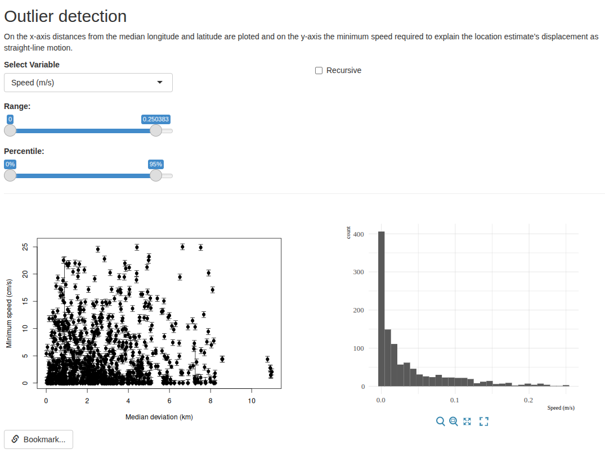

# Detect Outliers

MoveApps

Github repository: https://github.com/ctmm-initiative/ctmmMoveApp_outlier

  

## Description
This app removes relocations that are likely outliers based on a user-selected
range for either speed or distance. Based on the `outlie()` function of the ctmm
package.

## Documentation
This Shiny App uses `ctmm::outlie()` to calculate the distance from the
animal's median location and the minimum speed needed to explain the
relocation's displacement as straight-line motion, accounting for telemetry
error.

The App shows ctmm's outlier plot and a histogram of values for either
distance or speed. The user can adjust sliders to select a range of either
distance or speed values to include. Relocations outside the selected range
are removed from the output data and the App's plots.

### Application scope
#### Generality of App usability
This App was developed for any taxonomic group.

#### Required data properties
The App should work for any kind of location data that can be converted to a
`ctmm` `telemetry` object.

### Input type
`ctmm::telemetry.list`

### Output type
`ctmm::telemetry.list`

### Artefacts
none

### Settings
**Select Variable**: the variable used for filtering: speed (m/s) or distance
from the median location (m). Default: speed.

**Recursive**: If checked, filtering is done recursively. That is, each time
a relocation is removed, the speed is re-estimated using the remaining points.
Any newly-calculated speeds that also exceed the input threshold are then
removed, and so on until no speeds exceed the threshold. This option is only
available when filtering on speed.

**Range**: the range of the selected variable to retain in the data. Relocations
outside the range are removed. Default: the full range (nothing removed).

**Percentile**: the same range expressed as percentiles. It moves together with
**Range**, so either slider can be used.

**Store settings**: click to store the current settings of the app for future
workflow runs.

### Changes in output data
The App filters the input data based on the range selected by the user.
Relocations outside the selected range are removed from the output. Any animals
that have no locations within the selected range are removed from the output
entirely.

### Errors and null handling
**Animals with no relocations in range:** if all relocations of an animal are
removed, the animal is removed from the output. The App displays a note
and produces a warning when any animals are excluded in this way. If no animals
include any points that are in range, neither plot is displayed and the app
returns no data.

### Technical details
- Speed and distance are calculated per animal with `ctmm::outlie()`. See its
  documentation for how they are estimated:
  [outlie()](https://ctmm-initiative.github.io/ctmm/reference/outlie.html).
- Slider percentiles are pooled across all animals, so a percentile range does
  not remove the same share of relocations from each animal.
- With **Recursive**, `outlie()` is rerun after each round of removals, so the
  speeds used for filtering and in the plots are those of the remaining data.
  Only the upper end of the range drives the recursion; the lower end is then
  applied once.
- The data are filtered on every change in the App, so the output always
  reflects the current slider settings.
